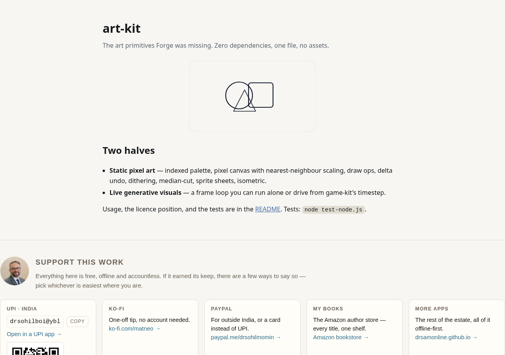

<div align="center">

# art-kit

[](LICENSE)



**The art primitives Forge was missing.** Zero dependencies, one file, no assets.

palette · pixel canvas · draw ops · undo · dithering · median-cut · sprite sheets · isometric · sketch loop

</div>

---

## The two halves

- **STATIC pixel art** — an indexed palette, a pixel canvas that scales with **nearest-neighbour** (smoothing off by default — the classic trap), draw ops, a delta undo stack, dithering, median-cut quantisation, sprite sheets, and the isometric mapping.
- **LIVE generative visuals** — a frame loop (`Art.sketch`) you can run on its own or drive from `game-kit`'s fixed timestep, so a sketch is reproducible from a fixed step.

Both, from one kit.

## What's in it

| | |
|---|---|
| `palette` | an indexed palette from a Lospec-style list, with `swap`, `cycle` and `nearest` |
| `canvas` | an indexed pixel buffer: `set`, `line`, `rect`, `ellipse`, `fill`, `mirror` |
| `scale` | nearest-neighbour upscaling (never smooths) |
| `history` | a bounded undo/redo stack that stores **deltas, not whole frames** |
| `dither` | ordered (Bayer) and Floyd–Steinberg |
| `quantize` | median-cut to N colours, so a photo becomes pixel art |
| `spriteSheet` / `sliceSprite` | a sheet + JSON atlas, with a slicing round-trip |
| `tilemap` | a grid of tile ids (`-1` = no tile, so tile `0` stays legal): `get`/`set`, pixel→tile by **floor**, `fillRect`, a capped iterative `floodFill`, 4-bit `autotile` masks, and `toCanvas(tiles)` |
| `anim` | a timeline over frames: `at(t)` is a **pure function of time**, `pingpong` without repeated endpoints, `fps 0` frozen instead of `NaN` |
| `generate` | a **seeded** sprite generator (`Art.rng`, mulberry32) that is mirror-symmetric by construction, never empty, and rebuilds an asset folder from one number (`generateSet`) |
| `iso` | the cartesian ↔ isometric coordinate mapping |
| `sketch` | a setup-once / draw-every-frame loop |

## Usage

```js
var Art = require("./art-kit.js");        // Node; in a browser it is window.Art

var pal = Art.palette("1a1c2c 5d275d b13e53 ef7d57");   // a Lospec-style list
var c = Art.canvas(32, 32, pal);
c.rect(4, 4, 24, 24, 2, true).ellipse(16, 16, 10, 10, 3, true);

var big = Art.scale(c, 8);                 // nearest-neighbour, crisp
var hist = Art.history(c, { limit: 100 }); // undo/redo over deltas
hist.begin(); c.set(0, 0, 1); hist.commit();
hist.undo();

var pal2 = Art.palette(Art.quantize(pixels, 16));       // median-cut a photo
var sheet = Art.spriteSheet([frame0, frame1]);          // sheet + atlas

// 1.1.0 — a level, its timeline, and a seeded creature to put in it
var map = Art.tilemap({ w: 20, h: 12, tileW: 16, tileH: 16 });
map.floodFill(0, 0, 1);                                 // lay a floor
var walls = map.autotile();                             // N=1 E=2 S=4 W=8 per tile
var level = map.toCanvas(tileCanvases);                 // compose it into one canvas

var hero = Art.generate({ seed: 2026, w: 16, h: 16, density: 0.8 });
var walk = Art.anim([hero, Art.generate({ seed: 77, w: 16, h: 16 })], { fps: 8, pingpong: true });
walk.at(0.3);                                           // the frame for that moment, always
```

## Licence position (read this)

Everything here is **reimplemented from published technique**; permissive reference projects are named only in comments, and **no code is copied**. In the survey behind this kit: Aseprite is not open source (learn, never copy); Data-Pixels and pixel8 carry **no licence**; six tools are copyleft — none of their code is used. The permissive references (piskel, Pixelorama, PixelCraft, poxi, and the isometric mapping from isometric-contributions) are cited as ideas.

## Tests

```
node test-node.js
86 passed, 0 failed
```

Covers the spec's required cases — a **nearest-neighbour scaling** case, a **dithering pattern** case, a **median-cut** case with a known input, a **sprite-sheet export round-trip**, a **tilemap** case (floor, flood-fill bounds, autotile masks), a **timeline** case (pure `at(t)`, pingpong without repeated endpoints) and a **procedural sprite** case (same seed, same sprite; mirror symmetry; never empty) — plus the palette, every draw op, the bounded delta undo stack, the isometric mapping and the sketch loop. All headless.

The 1.1.0 additions were **mutation-tested ten ways** and all ten are caught by an assertion (floor→truncate in `at`, a flood fill that re-fills, swapped E/W autotile bits, `toCanvas` ignoring the tile id, pingpong repeating its endpoints, rounded instead of floored time, mirroring only on even widths, dropping the non-empty guarantee, ignoring the body shape, and `Art.version` drifting from `VERSION`).

## Support


Free, offline, accountless — and staying that way. If it earned its keep:

| | |
|---|---|
| UPI (India) | `drsohilboi@ybl` — payee Dr. Sohil Momin, open amount, or scan [the QR](docs/assets/upi-qr.svg) |
| GitHub Sponsors | [github.com/sponsors/drsamonline](https://github.com/sponsors/drsamonline) |
| Ko-fi | [ko-fi.com/matneo](https://ko-fi.com/matneo) |
| PayPal | [paypal.me/drsohilmomin](https://paypal.me/drsohilmomin?locale.x=en_GB&country.x=IN) |
| My books | [Amazon author store](https://www.amazon.com/stores/author/B08ZT331LY/allbooks?ccs_id=aed72b9f-71d9-41dc-adee-e9368a317acc) |
| More apps | [drsamonline.github.io](https://drsamonline.github.io/) |
| Email | [sohilmomin2000@gmail.com](mailto:sohilmomin2000@gmail.com) |

Nothing is gated behind it: no accounts, no tracking, no network requests.

## License

PolyForm Noncommercial — see [LICENSE](LICENSE). © 2026 Dr Sohil Momin.
